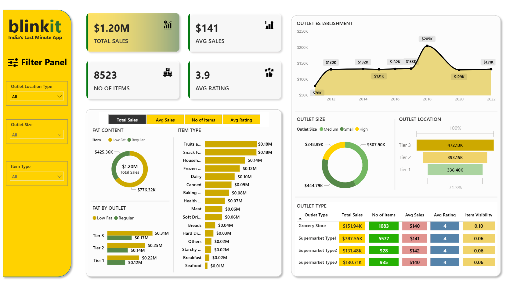
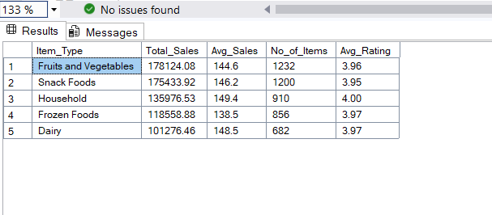
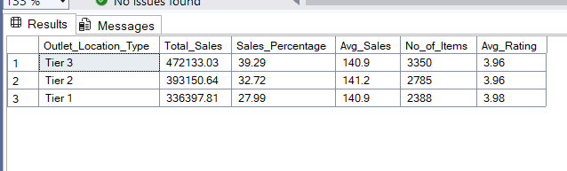
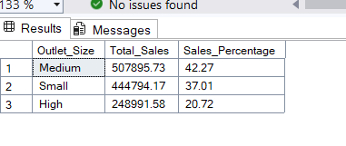
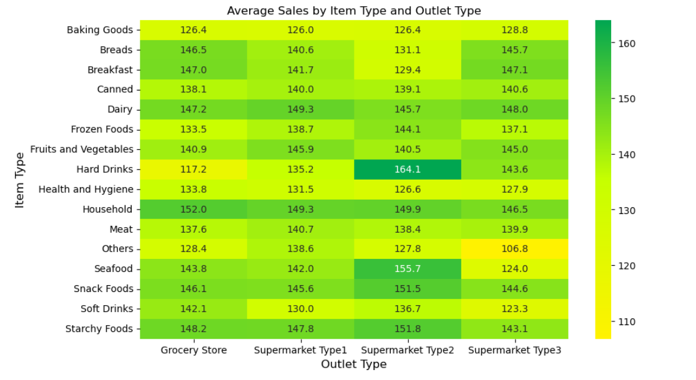

# Blinkit Sales Analysis | Python, SQL, Power BI & Streamlit

A portfolio adaptation for exploring sales and outlet patterns in a supplied grocery item/outlet dataset. The project includes Python EDA, SQL Server analysis, a Streamlit dashboard, and a Power BI report artifact.

> **Attribution:** The inherited project is credited to [Ashutosh Sahoo](https://github.com/Ashuytosh/Blinkit_Data_Analysis). The original MIT license is retained in [LICENSE](LICENSE). New portfolio improvements and documentation in this adaptation are by **Praful Kinkar**. The upstream materials available here do not identify a definitive separate publisher/source or license for the dataset; that provenance is unverified. Please confirm data redistribution terms before republishing.

## Project overview

The analysis reviews a static snapshot of item/outlet records. It compares recorded sales totals and averages, ratings, product categories, outlet types/sizes/location tiers, and item visibility. The work emphasizes reproducible preparation, consistent KPI definitions, readable exploratory analysis, and careful interpretation.

## Business problem

How can a data analyst describe sales distribution across product and outlet categories, identify groups worth further investigation, and present those summaries in accessible tools without overstating what a limited snapshot can prove?

## Objectives

- Inspect and validate the supplied dataset and its missingness.
- Normalize category labels without modifying the raw CSV.
- Calculate comparable, consistently defined sales and rating KPIs.
- Explore item, outlet, location, size, fat-content, and establishment-year patterns.
- Demonstrate Python, SQL Server T-SQL, Power BI, and Streamlit workflows.
- Document data limitations and avoid unsupported causal or currency claims.

## Technology stack

Python 3.11+, pandas, NumPy, Matplotlib, Seaborn, Streamlit, pytest, SQL Server T-SQL, Power BI Desktop, Jupyter Notebook.

## Dataset description and source

The repository includes raw and cleaned CSVs and an Excel copy under `Dataset/`. The raw CSV contains **8,523 rows and 12 columns**; the cleaned CSV contains the same 8,523 records in 13 columns. Fields cover item identifiers/categories, outlet attributes, item visibility/weight, recorded sales, and rating.

The dataset files are inherited project materials. The upstream repository credits Ashutosh Sahoo, but the upstream materials in this repository do not establish a separate original dataset publisher, source URL, or dataset redistribution license. The exact provenance is therefore **not verified**. Do not treat the MIT license for the project code as proof of a dataset license.

## Repository structure

```text
.
├── .devcontainer/                 # Optional Python dev container
├── Dataset/                       # Raw, cleaned, and source workbook files
├── Design_Assets/                 # Existing dashboard design assets
├── docs/                          # Data dictionary, methods, Power BI, audit notes
├── Output_Screenshots/            # Existing analysis and dashboard screenshots
├── Result_csv/                    # Existing exported SQL/analysis summaries
├── tests/                         # Dataset and dashboard KPI validation
├── app.py                         # Filterable Streamlit dashboard
├── Blinkit_Data_Analysis_Python.ipynb
├── Blinkit_Data_Analysis_SQL.sql  # SQL Server T-SQL analysis
├── Blinkit_Dashboard_Power_BI.pbix
├── LICENSE                        # Original MIT notice retained
└── requirements.txt
```

## Data cleaning methodology

The notebook reads the raw CSV from `Dataset/`, preserves the original, standardizes the observed fat-content variants (`LF`, `low fat`, `reg`), renames `Total Sales` to `Sales` for Python analysis, and validates numeric measures. It reports missing and duplicate records and flags potential sales outliers with IQR fences without automatically removing them. The 1,463 missing item weights are retained without imputation. See [data_dictionary.md](docs/data_dictionary.md) and [methodology.md](docs/methodology.md).

## Exploratory data analysis

The notebook covers dataset overview, data types, missing values, duplicates, outlier checks, sales contribution, sales by item type/outlet type/outlet size/location tier, rating comparisons, visibility-versus-sales exploration, and a numeric correlation heatmap. Charts are labeled, and explanatory text distinguishes sales totals from per-record averages. Correlation is descriptive and does not establish causation.

## SQL analysis

[Blinkit_Data_Analysis_SQL.sql](Blinkit_Data_Analysis_SQL.sql) uses SQL Server syntax and assumes `blinkit_db.dbo.blinkit_data` imported from the cleaned snapshot with source-style underscore column names and normalized fat-content values. It includes consistent all-record KPIs, sales summaries, window-function contributions/ranks, and an **Additional Business Analysis** section answering the ten requested business questions. It previews standardized fat-content values rather than mutating source rows. Adjust the import/table mapping for your SQL Server environment.

## Power BI dashboard

The existing [PBIX artifact](Blinkit_Dashboard_Power_BI.pbix) and report screenshot are retained. The PBIX connection metadata references a remote dataset/report; this environment could not verify access to the service model or safely edit/refresh the report. The provided [Power BI setup guide](docs/power_bi_setup.md) includes consistent DAX measures, visual/slicer recommendations, and manual validation steps. No PBIX changes are claimed.

## Streamlit dashboard

The app reads the cleaned dataset directly and provides sidebar filters for item type, outlet type, outlet size, and location tier, with **All** selected by default. Clearing selections also includes all records. Filter context applies to the KPI cards and charts. It includes sales summaries, rating analysis, visibility-versus-sales exploration, live key summaries, data preview, and a filtered CSV download. Missing files, missing columns, and invalid KPI values are reported in the interface.

## KPI definitions

| KPI | Definition |
|---|---|
| Total Sales | Sum of non-missing recorded `Sales` values |
| Average Sales | Mean recorded `Sales` value per row |
| Number of Records | Count of rows with non-missing `Sales` |
| Average Rating | Mean row-level `Rating` |

The source has no documented currency, sales period, transaction date, or sold quantity. Therefore no currency symbol is used, establishment year is not treated as a transaction-year filter, and record counts are not called units/items sold.

## Actual findings from the supplied cleaned CSV

These are reproducible descriptive aggregates calculated from the included snapshot, not inferred business causes:

- **8,523 records** and **1,201,681.4808** total recorded sales; average sales are **140.9928 per record**; average rating is **3.9659 / 5**.
- **1,463** `Item Weight` values are missing; **0** exact full-row duplicates were found.
- Fruits and Vegetables has the highest item-type total (**178,124.0810**, approximately **14.82%** of total recorded sales), followed by Snack Foods (**175,433.9204**).
- Tier 3 has the largest location-tier total (**472,133.0272**, approximately **39.29%**).
- Outlet **OUT035** has the highest outlet total (**133,103.907**, approximately **11.08%** of total sales). Eight of ten outlets are above the mean outlet total; these are snapshot totals, not profitability measures.
- Medium outlet size has the largest size-group total (**507,895.7284**), in part because it contains more records. High outlet size has the largest *average sales per record* (**142.0374**); these are different comparisons.
- Using dataset-wide average item-type sales and mean rating as explicit relative cutoffs, Meat and Health and Hygiene are above the average rating but below the average category sales. These thresholds are exploratory, not business-defined targets.
- The lowest item-type mean rating is Breads (**3.8813**); the highest is Meat (**4.0231**). These are small descriptive differences on the observed 1–5 scale.
- Pearson correlation between `Item Visibility` and `Sales` is approximately **-0.0013** in this dataset. This near-zero linear association is not evidence that visibility has no other relationship and does not imply causation.

## Business recommendations for follow-up

- Investigate high-sales categories and location tiers together with record counts, margins, inventory, and transaction-period data before making operational decisions.
- Review categories with lower average ratings alongside rating counts and customer feedback; do not infer product quality from aggregate ratings alone.
- Compare outlet sizes using both total sales and per-record averages; the leading total group is not the leading average group.
- Acquire transaction dates, quantities, currency/units, and cost/margin data to support trend, volume, and profitability analyses that this snapshot cannot answer.
- Treat visibility findings as a hypothesis for a controlled follow-up analysis, not a causal recommendation.

## Screenshots

The following existing screenshots are available. They are inherited static visuals; the original dashboard screenshot includes legacy dollar/count labels and should be replaced after validating the updated Streamlit/Power BI dashboards. Image links below use repository-relative paths.

| View | Screenshot |
|---|---|
| Existing dashboard overview |  |
| Sales by item type |  |
| Sales by outlet location tier |  |
| Sales by outlet size |  |
| Average sales by item and outlet type |  |

## Installation (Windows)

From the cloned repository folder, open PowerShell and run:

```powershell
python -m venv venv
venv\Scripts\activate
pip install -r requirements.txt
```

To validate the dataset and calculations:

```powershell
python -m pytest
```

## Run the Streamlit application

```powershell
streamlit run app.py
```

Streamlit opens the local dashboard in your browser. The app expects `Dataset/Blinkit_Cleaned_Data.csv` relative to the project root.

## Project limitations

- This is a static, inherited snapshot, not transaction-level data.
- No transaction date, order identifier, quantity, currency, sales period, margin, or cost is documented.
- Item weight is missing in 1,463 records and is not imputed.
- Aggregated comparisons are descriptive and may reflect different numbers of records.
- The PBIX's referenced semantic model may require external Power BI access; its refreshability was not verified here.
- The original dataset publisher and data redistribution terms are not verified in the materials inspected.

## Future improvements

- Confirm dataset provenance and redistribution permissions; add a source citation if verified.
- Replace static screenshots after reviewing and refreshing the Power BI report in an authorized environment.
- Add database import instructions and execute the T-SQL against a documented SQL Server schema.
- Extend analysis when transaction dates, quantities, costs, and margins are available.
- Add automated dashboard smoke testing and a documented data refresh process.

## Author

- **Praful Kinkar**
- GitHub: [Prafulkin](https://github.com/Prafulkin)
- LinkedIn: [praful-kinkar](https://www.linkedin.com/in/praful-kinkar/)

## Interview summary

“I audited an inherited grocery sales analysis project and made its data preparation and reporting more reproducible. I standardized documented category labels, validated missingness and duplicates, and aligned Python, SQL, and Streamlit KPI definitions so record count is not mistaken for units sold and undocumented currency is not assumed. I used SQL Server window functions for category contributions and outlet rankings, added a filter-responsive Streamlit dashboard, and documented the Power BI work that requires external model access. The analysis is descriptive: the dataset has no transaction dates or quantities, so I avoid causal and trend claims.”
